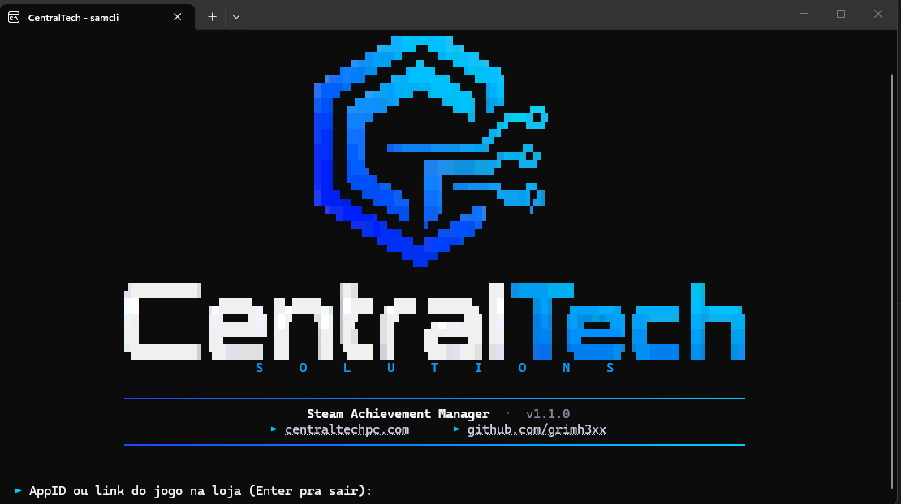
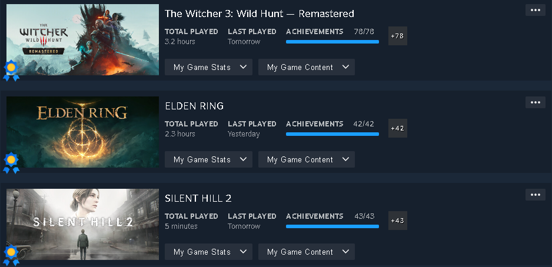
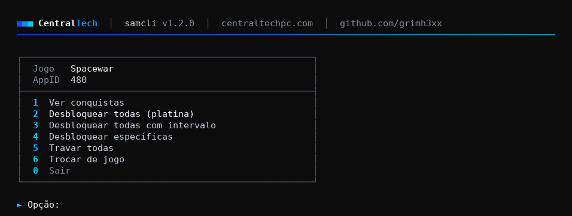
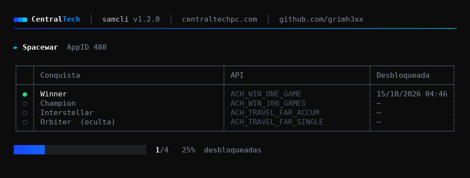
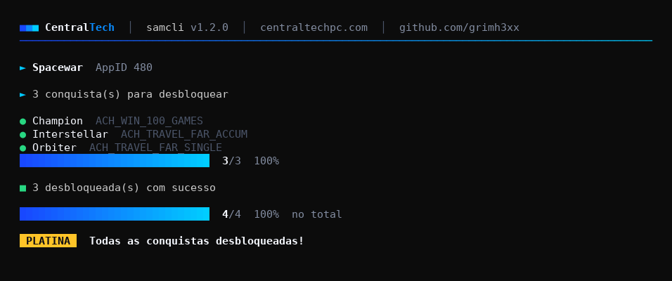

<div align="center">



# samcli

**Steam Achievement Manager de terminal, escrito em C puro.**
Windows e Linux · um executável pequeno · sem precisar do Steamworks SDK pra compilar


[Download](https://github.com/grimh3xx/samcli-win-x64/releases) · [Como usar](#como-usar) · [Como funciona](#como-funciona) · [Compilar](#compilando)

</div>

---

## Funciona

Resultado real na minha conta: platina com poucos minutos ou horas de jogo.



## Recursos

- Lista, desbloqueia e trava conquistas: todas ou só as que você escolher
- Menu interativo: é só dar dois cliques no `.exe`
- `--delay 30s`: desbloqueia uma conquista por vez, com horários espaçados
- Vários jogos com um comando só
- Aceita o AppID ou o link da loja direto
- Mostra o nome do jogo (lido das bibliotecas da Steam) e a data de cada conquista
- Interface com cor 24-bit, logo em pixel art, barra de progresso e selo **PLATINA**
- Funciona com `steam_api` de SDK antigo **e** novo (≥ 1.61)

## Como usar

> A Steam precisa estar **aberta e logada**, e o jogo precisa estar na sua conta (não precisa estar instalado).
> O AppID está na URL da loja: `store.steampowered.com/app/`**`2124490`**`/SILENT_HILL_2/`

### Windows

1. Baixe o `samcli-windows-x64.exe` em [Releases](https://github.com/grimh3xx/samcli-win-x64/releases).
2. Coloque a **`steam_api64.dll`** na mesma pasta. Ela vem com quase todo jogo da Steam: procure `steam_api64.dll`
   dentro de `C:\Program Files (x86)\Steam\steamapps\common\` e copie uma.
3. Dê dois cliques no `.exe` pro menu, ou use pelo terminal:

```powershell
.\samcli.exe                                  # menu interativo
.\samcli.exe 2124490 list                     # lista as conquistas
.\samcli.exe 2124490 unlock-all               # platina
.\samcli.exe 2124490 unlock-all --delay 30s   # uma a cada 30 s
```

> O visual completo aparece no **Windows Terminal** (padrão no Windows 11). No console antigo, use `--plain`.

### Linux <sup>experimental</sup>

1. Baixe o `samcli-linux-x64` em [Releases](https://github.com/grimh3xx/samcli-win-x64/releases) (ou [compile](#compilando)).
2. Coloque uma **`libsteam_api.so` de 64 bits** na mesma pasta. Ela vem com os jogos nativos de Linux:

```bash
find ~/.local/share/Steam/steamapps/common -name libsteam_api.so -exec file {} \; | grep 64-bit
cp "/caminho/que/apareceu/libsteam_api.so" .
```

   Também tem no [Steamworks SDK](https://partner.steamgames.com/downloads/list), em `redistributable_bin/linux64/`.

3. Rode:

```bash
chmod +x samcli-linux-x64
./samcli-linux-x64                            # menu interativo
./samcli-linux-x64 2124490 unlock-all         # platina
```

> Feito pra Steam nativa (`~/.steam/steam` ou `~/.local/share/Steam`). A Steam em Flatpak/Snap roda em sandbox e pode não aceitar a conexão.

### Comandos

| Comando | O que faz |
|---|---|
| `samcli` | menu interativo |
| `samcli <appid> list` | lista as conquistas (status, nome, API, data) |
| `samcli <appid> unlock-all` | desbloqueia todas |
| `samcli <appid> unlock <API> [...]` | desbloqueia só as escolhidas (nomes da coluna API) |
| `samcli <appid> lock-all` | trava todas |
| `samcli <appid> lock <API> [...]` | trava só as escolhidas |
| `samcli <appid> <appid> ... <cmd>` | vários jogos em sequência |

| Opção | |
|---|---|
| `--delay <tempo>` | intervalo entre conquistas: `30s`, `2m` ou milissegundos |
| `--plain` | sem cores (ou defina a variável `NO_COLOR`) |
| `--help`, `--version` | |

## Interface

| Menu | Lista de conquistas |
|---|---|
|  |  |



<sub>Prévias geradas com o Spacewar (AppID 480, o app de teste da Valve).</sub>

## Como funciona

1. Define `SteamAppId=<id>` no ambiente do processo.
2. Carrega a `steam_api64.dll` / `libsteam_api.so` em tempo de execução (`LoadLibrary` / `dlopen`) e chama `SteamAPI_InitFlat`, ou `SteamAPI_Init` nas versões antigas. A Steam passa a tratar o processo como o jogo.
3. Pega `ISteamUserStats` (`v013` → `v012` → `v011` → `SteamInternal_FindOrCreateUserInterface`).
4. Espera as stats sincronizarem e chama `SetAchievement` / `ClearAchievement` + `StoreStats`.

Como um processo só pode "ser" um AppID por vez, o menu e o modo de vários jogos relançam o próprio executável (`--child`) uma vez por jogo (`CreateProcess` no Windows, `fork`/`execv` no Linux).

```
src/
├─ main.c          CLI, comandos e menu interativo
├─ steam.c/.h      camada sobre a API flat do Steamworks
├─ ui.c/.h         interface de terminal (cores, logo, tabela, progresso)
├─ platform.c/.h   o que muda entre Windows e Linux
└─ logo_data.h     logo convertida (gerada por tools/gen_logo.py)
```

## Compilando

Não precisa do Steamworks SDK: a API é carregada em tempo de execução.

```bash
# Windows ou Linux, com CMake
cmake -S . -B build -DCMAKE_BUILD_TYPE=Release
cmake --build build --config Release

# atalhos
build.bat        # Windows (MSVC ou MinGW)
./build.sh       # Linux (gcc ou clang)
```

Quando a versão no `CMakeLists.txt` muda, o GitHub Actions compila e solta uma Release com os binários de Windows e Linux.

Pra trocar a logo, substitua `assets/logo.png` e rode `python tools/gen_logo.py` (precisa de Pillow e NumPy).

## Limitações

- Jogos com stats validadas no servidor (alguns multiplayer) podem recusar ou reverter a alteração.
- Enquanto roda, a Steam mostra você "jogando" aquele jogo.
- Mexer em conquistas vai contra o espírito dos termos da Steam. Use por sua conta e risco, e **evite jogos com VAC/competitivos**.

## Créditos

Inspirado no [SteamAchievementManager](https://github.com/gibbed/SteamAchievementManager) do gibbed.
Código escrito do zero, sem relação com a Valve.

## Licença

[MIT](LICENSE) © Daniel Gomes de Oliveira · CentralTech Solutions
